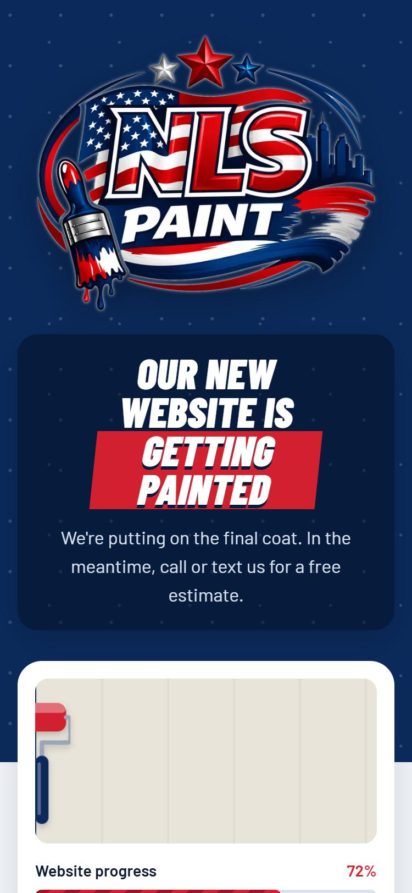

<div align="center">

<a href="https://nlspaint.com"></a>

# NLS Paint

**Site institucional de uma empresa de pintura residencial e comercial em Massachusetts e Rhode Island (EUA).**

[](https://nlspaint.com)
[](https://nlspaint.com)


[**🌐 Ver o site**](https://nlspaint.com) · [Sobre o projeto](#-sobre-o-projeto) · [Destaques](#-destaques) · [Como rodar](#-como-rodar)

</div>

---

## 📌 Sobre o projeto

A **NLS Paint** é uma empresa de pintura com base em Woonsocket, RI, que atende casas e comércios num raio de cerca de 70 milhas de Milford, MA. O cliente não tinha presença na web, e o objetivo do projeto é **gerar orçamentos pelo celular** e **ser encontrado no Google por buscas locais**.

Esta primeira entrega é uma página **"em construção"** que já trabalha pelo negócio: em vez de uma tela parada, ela apresenta a marca, mostra onde a empresa atende e o que faz, e leva o visitante a ligar ou mandar mensagem em um toque.

| | |
|---|---|
| **Cliente** | NLS Paint (pintura residencial e comercial) |
| **Público** | Proprietários e comércios em MA e RI, em sua maioria pelo celular |
| **Meu papel** | Entrevista com o cliente, identidade visual na web, design, desenvolvimento, SEO e deploy |
| **Site** | [nlspaint.com](https://nlspaint.com) |

<div align="center">
  
  <br><sub>A página no celular (375 px)</sub>
</div>

## ✨ Destaques

### 🎨 Animações que imitam o ato de pintar
Nada de efeitos genéricos de deslizar ou balançar. Três pinceladas vermelho/branco/vermelho atravessam o topo como na logo, e um **rolo de tinta desenhado em SVG** pinta a parede ao vivo, revelando "NLS PAINT · coming soon", com respingos escorrendo e uma barra de progresso. Tudo em **CSS puro**, sem biblioteca.

### 📱 Mobile first, focado em conversão
- Botão principal **Call (774) 586-9824** (`tel:`) e **Send a text** (`sms:`) com a mensagem já escrita: *"Hi Maicow, I'd like a free painting estimate. My town is: "*.
- Botão **Copy number** usando a Clipboard API, com fallback que seleciona o número em navegadores sem permissão.
- Uma coluna no celular que se reorganiza a partir de 760 px.

### 🔎 SEO local desde o primeiro dia
- `title` e `description` com serviço, cidades e telefone.
- URL canônica, Open Graph e Twitter Card com imagem de compartilhamento própria (1200×630).
- Favicon em SVG, PNG 48 px e `apple-touch-icon`.
- `robots.txt` liberando a indexação.

### ♿ Acessibilidade e performance
- Respeita `prefers-reduced-motion`: quem pede menos movimento não vê as animações.
- Foco visível (`:focus-visible`), seções com `aria-labelledby`, cena decorativa com `aria-hidden` e aviso de cópia com `role="status"`.
- Logo em **WebP** com `fetchpriority="high"`, `width`/`height` declarados e `aspect-ratio` para não haver salto de layout.
- **Uma página em um único arquivo** (HTML + CSS + JS, cerca de 15 KB), sem framework e sem etapa de build.

### 🧭 Identidade visual tirada da logo
Paleta em variáveis CSS a partir das cores da marca, com a tipografia **Barlow Condensed** (títulos em itálico, como pinceladas) e **Barlow** (texto).

| Token | Cor | Uso |
|---|---|---|
| `--navy` |  | Fundo do topo, estrutura |
| `--red` |  | Chamadas para ação e destaques |
| `--paper` |  | Fundo das seções |

## 🛠️ Stack e infraestrutura

| Camada | Tecnologia |
|---|---|
| Front-end | HTML5, CSS3 (animações com `@keyframes`), JavaScript puro |
| Servidor | Nginx 1.27 (Alpine) com gzip e cache de 30 dias para `/assets/` |
| Container | Docker |
| Hospedagem | EasyPanel (VPS) |
| Métricas | Painel de tráfego próprio |

```
nlspaint/
├── index.html      # a página inteira: HTML, CSS e JS
├── assets/         # logo (WebP), favicons e imagem de compartilhamento
├── robots.txt
├── nginx.conf      # gzip, cache dos assets e fallback para index.html
├── Dockerfile      # imagem nginx:alpine servindo na porta 80
└── docs/           # capturas de tela usadas neste README
```

## 🚀 Como rodar

**Sem instalar nada:** abra o `index.html` no navegador.

**Com Docker**, igual à produção:

```bash
docker build -t nlspaint .
```

```bash
docker run --rm -p 8080:80 nlspaint
```

Depois acesse `http://localhost:8080`.

## 🗺️ Próximos passos

O site completo já está planejado e vai substituir esta página:

- [x] Página "em construção" com contato, área de atendimento e serviços
- [x] Deploy com Docker + Nginx e domínio próprio
- [ ] Home completa com galeria de projetos reais e antes/depois
- [ ] Páginas para os 6 serviços (pintura interna e externa, tetos e acabamentos, piso epóxi, lavagem com alta pressão, reparo de drywall)
- [ ] Páginas de projeto com fotos e a cidade de cada obra
- [ ] Páginas de cidade criadas só a partir de projetos reais, sem páginas duplicadas
- [ ] Dados estruturados `HousePainter` (LocalBusiness), `FAQPage` e `BreadcrumbList`

---

<div align="center">

Feito por **[Wanderson](https://github.com/wanderson1873)** para a **NLS Paint** · [nlspaint.com](https://nlspaint.com)

</div>
