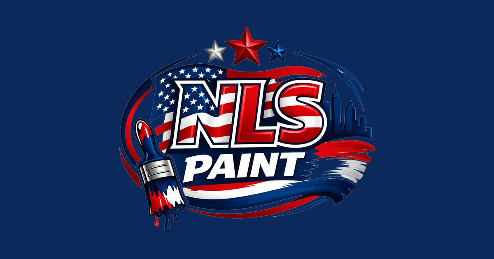
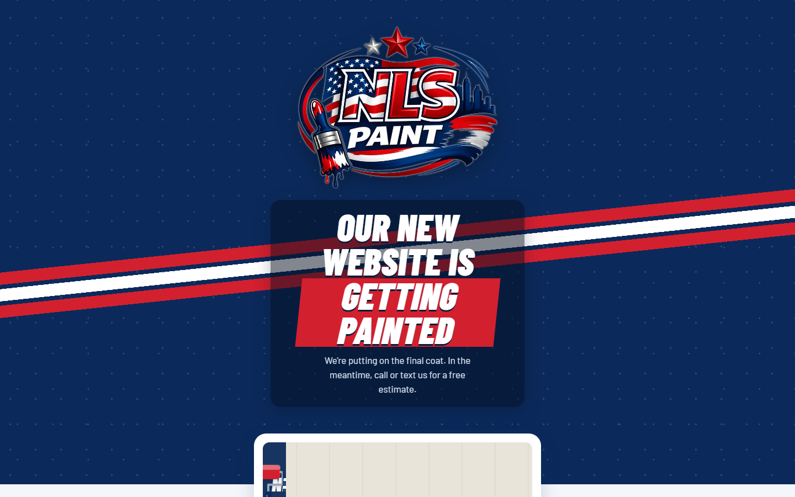
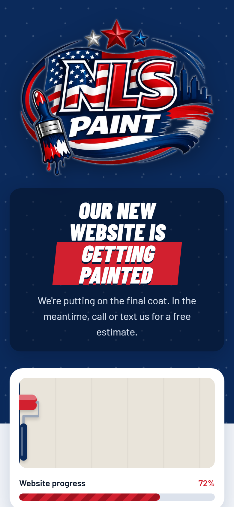

<div align="center">

[🇺🇸 English](README.md) · **🇧🇷 Português**

<a href="https://nlspaint.com"></a>

# NLS Paint

**Primeira presença na web de uma empresa de pintura residencial e comercial em Massachusetts e Rhode Island (EUA), feita para gerar pedidos de orçamento pelo celular.**

[](https://nlspaint.com)
[](https://nlspaint.com)


[**🌐 Ver o site**](https://nlspaint.com) · [Sobre](#-sobre) · [Telas](#-telas) · [Destaques](#-destaques) · [Como rodar](#-como-rodar)

</div>

---

## 📌 Sobre

A NLS Paint é uma empresa de pintura com base em Woonsocket, RI, que atende casas e comércios num raio de cerca de 70 milhas de Milford, MA. O cliente não tinha presença na web, e o objetivo é **gerar orçamentos pelo celular** e **ser encontrado no Google por buscas locais**.

Esta primeira entrega é uma página "em construção" que já trabalha pelo negócio: apresenta a marca, mostra onde a empresa atende e o que faz, e leva o visitante a ligar ou mandar mensagem em um toque.

| | |
|---|---|
| **Cliente** | NLS Paint, pintura residencial e comercial em MA e RI |
| **Público** | Proprietários e comércios em MA e RI, em sua maioria pelo celular |
| **Meu papel** | Entrevista com o cliente, identidade visual na web, design, desenvolvimento, SEO e deploy |
| **Ano** | 2026 |
| **Site** | [nlspaint.com](https://nlspaint.com) |

## 📸 Telas

<div align="center">
  
  &nbsp;
  
  <br><sub>A página no computador e no celular (390 px)</sub>
</div>

## ✨ Destaques

- **Animações que imitam o ato de pintar.** Três pinceladas vermelho/branco/vermelho atravessam o topo como na logo, e um rolo de tinta em SVG pinta a parede ao vivo, revelando "NLS PAINT · coming soon". Tudo em CSS puro, sem biblioteca.
- **Mobile first, focado em conversão.** Botões **Call** (`tel:`) e **Send a text** (`sms:`) com a mensagem já escrita, e botão **Copy number** com alternativa para navegadores que bloqueiam a área de transferência.
- **SEO local desde o primeiro dia.** Title e description com serviço, cidades e telefone, URL canônica, Open Graph e Twitter Card com imagem própria de 1200×630 e o conjunto completo de favicons.
- **Acessível e rápido.** Respeita `prefers-reduced-motion`, foco visível, rótulos ARIA e logo em WebP com dimensões declaradas para o layout não pular. A página inteira é um arquivo de cerca de 15 KB, sem etapa de build.
- **Paleta tirada da logo:** azul-marinho `#0B2A5B`, vermelho `#D2202F` e papel `#F4F6FA`, com Barlow Condensed em itálico nos títulos, como pinceladas.

## 🚀 Como rodar

**Sem instalar nada:** abra o `index.html` no navegador.

**Com Docker**, igual à produção:

```bash
docker build -t nlspaint .
```

```bash
docker run --rm -p 8080:80 nlspaint
```

Depois acesse `http://localhost:8080`.

## 🗺️ Próximos passos

- [x] Página "em construção" com contato, área de atendimento e serviços
- [x] Deploy com Docker + Nginx e domínio próprio
- [ ] Home completa com galeria de projetos reais e antes/depois
- [ ] Uma página para cada um dos 6 serviços
- [ ] Páginas de projeto com fotos e a cidade de cada obra
- [ ] Páginas de cidade criadas só a partir de projetos reais
- [ ] Dados estruturados `HousePainter` (LocalBusiness), `FAQPage` e `BreadcrumbList`

---

<div align="center">

**Wanderson Oliveira** · Sites e soluções com IA que trazem mais clientes para o seu negócio

[](https://derson.cloud)
[](mailto:wanderson1873@gmail.com)
[](https://www.linkedin.com/in/wanderson1873/)
[](https://wa.me/17816664150)

<sub>© 2026 NLS Paint. Todos os direitos reservados. Código exibido como amostra de portfólio.</sub>

</div>
